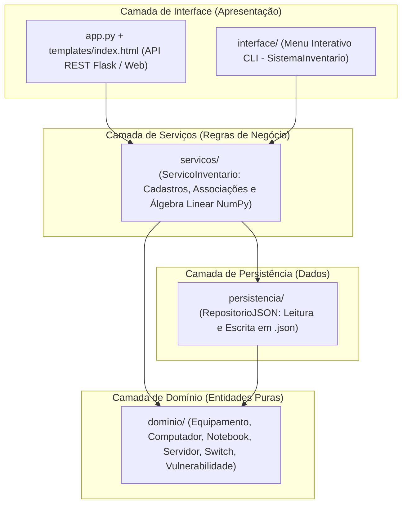

# 🛡️ API de Inventário e Análise de Risco (Trabalho 02)

Sistema desenvolvido em Python utilizando Programação Orientada a Objetos (POO) e Álgebra Linear para gerir inventários de ativos de cibersegurança. O sistema calcula o risco efetivo de vulnerabilidades através da resolução de sistemas lineares, sendo disponibilizado via API RESTful com Flask e empacotado em container Docker.

## 🚀 Tecnologias Utilizadas
* **Python 3.11**
* **Flask** (API RESTful e Interface Web)
* **NumPy** (Cálculo matricial e validação de invertibilidade)
* **Docker** (Containerização)
* **Pytest & Unittest** (Testes automatizados)

---

## 🏛️ Arquitetura de Software e Separação em Camadas (S4_01)

O projeto foi estruturado em pacotes independentes seguindo o padrão de **Arquitetura em Camadas**, separando claramente a interface de utilizador, as regras de negócio/serviços, as entidades de domínio e a persistência de dados.

### Diagrama de Camadas



### Responsabilidade de Cada Camada

1. **`dominio/` (Camada de Domínio):**
   * Contém exclusivamente as classes de negócio puras (`Equipamento`, subclasses polimórficas `Computador`, `Notebook`, `Servidor`, `Switch`, e `Vulnerabilidade`).
   * **Isolamento:** Não importa módulos de persistência (`json`) nem de interface (`flask`, `input`/`print`).
2. **`persistencia/` (Camada de Persistência):**
   * Contém a classe `RepositorioJSON`, responsável unicamente pela leitura e gravação dos dados nos ficheiros `equipamentos.json` e `vulnerabilidades.json`.
3. **`servicos/` (Camada de Serviços):**
   * Contém a classe `ServicoInventario`, que centraliza todas as operações de negócio: registo de equipamentos, associação de vulnerabilidades, validação de dependências e o cálculo matricial do sistema linear $(I - A)x = b$ com `NumPy`.
4. **`interface/` e `app.py` (Camada de Interface):**
   * Divide-se entre a interface de linha de comandos (`interface/`) e a interface Web/API REST (`app.py` + `templates/index.html`), que apenas recebem entradas do utilizador e consomem a camada de serviços.

---

## ⚙️ Funcionalidades
* **CRUD Completo:** Gestão de equipamentos (Computadores, Notebooks, Servidores, Switches) com aplicação de Polimorfismo no fator de exposição ao risco.
* **Cálculo de Risco Matricial:** Resolução matemática do sistema $(I - A)x = b$ utilizando NumPy para encontrar o risco efetivo com base na dependência entre ativos.
* **Validação Numérica:** Verificação do determinante e da invertibilidade da matriz $(I - A)$ antes da resolução.

## 🐳 Como Executar com Docker
Certifique-se de que possui o Docker instalado e a rodar. No terminal, dentro da pasta do projeto, execute:

1. **Construir a imagem da API:**
   ```bash
   docker build -t api-inventario .
   ```
2. **Iniciar o container:**
   ```bash
   docker run -p 5000:5000 api-inventario
   ```
